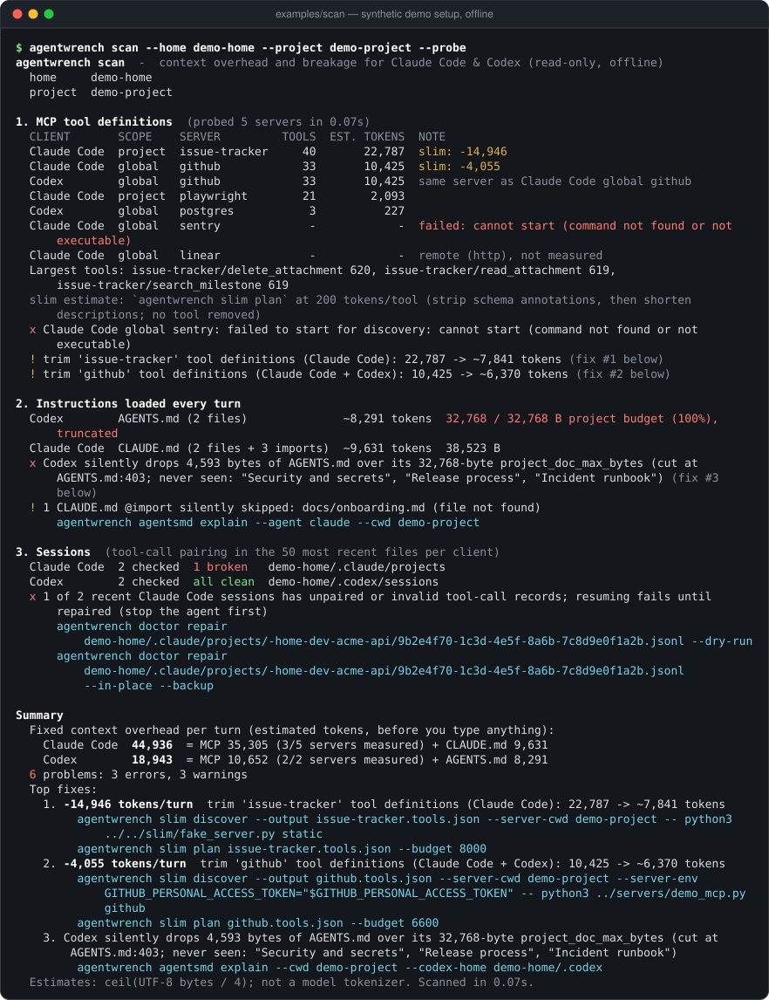
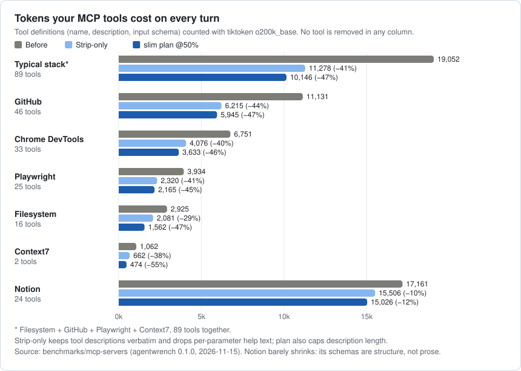

<p align="center">
  <picture>
    <source media="(prefers-color-scheme: dark)" srcset="assets/logo-dark.svg">
    
  </picture>
</p>

<p align="center">
  <strong>Find the tokens and breakages your coding-agent setup silently costs you, then fix them.</strong><br>
  One offline CLI for Claude Code, Codex and MCP.
</p>

<p align="center">
  <a href="https://github.com/tianhaogutum/agentwrench/actions/workflows/ci.yml"></a>
  <a href="https://pypi.org/project/agentwrench/"></a>
  <a href="https://pypi.org/project/agentwrench/"></a>
  <a href="LICENSE"></a>
</p>

<p align="center">
  English · <a href="README.zh-CN.md">简体中文</a>
</p>

<p align="center">
  <strong>89 MCP tools = 19,052 tokens on every turn. <code>agentwrench slim</code> cuts that to 10,146 (−47%) without hiding a tool.</strong><br>
  <sub>Filesystem + GitHub + Playwright + Context7, counted with tiktoken <code>o200k_base</code>. <a href="benchmarks/mcp-servers/README.md">Benchmark and method</a>.</sub>
</p>

```sh
uvx agentwrench scan          # or: pipx install agentwrench  /  pip install agentwrench
```

<p align="center">
  
</p>
<p align="center"><sub>Real output on the bundled synthetic setup (<code>examples/scan</code>, fictional servers, no network). Regenerate with <code>assets/render_terminal.py</code>.</sub></p>

## Quick start

```sh
uvx agentwrench scan            # read-only: this project, ~/.claude.json, ~/.claude, ~/.codex
uvx agentwrench scan --probe    # also start each stdio MCP server once and count its tool tokens
```

No account, no API key, no config. To try it without touching your own setup, run the demo above from a clone:

```sh
git clone https://github.com/tianhaogutum/agentwrench && cd agentwrench
uvx agentwrench scan --home examples/scan/demo-home --project examples/scan/demo-project --probe
```

Install it for good with `pipx install agentwrench` or `pip install agentwrench` (Python 3.11+; Linux and macOS, Windows untested).

## What `scan` finds

| Section | What it measures | What it flags | Fixed by |
| --- | --- | --- | --- |
| MCP tool definitions | Tokens each server's tools cost per turn, per client and scope (Claude Code global/local/project, Codex global/project) | Servers worth slimming, servers that fail to start, the same server loaded by two clients | [`slim`](#cut-mcp-tool-definitions-in-half-slim) |
| Instructions loaded every turn | The AGENTS.md chain against Codex's 32 KiB project budget; CLAUDE.md plus its `@imports` | Bytes Codex silently drops and the headings it never sees; `@imports` Claude Code silently skips | [`agentsmd`](docs/agentsmd.md) |
| Sessions | Tool-call pairing in the 50 most recent session files per client | Sessions that will fail on `--resume` | [`doctor`](docs/doctor.md) |
| Handoff packs (shown only when the project holds one) | Whether each `agentwrench handoff` pack in the project still matches the repository | Packs that went stale or were edited | [`handoff`](#tests-pass-but-against-which-code--handoff) |

The summary adds it up per client ("fixed context overhead per turn, before you type anything") and lists the top three fixes by tokens saved, each with the exact command. `--json` prints a stable schema ([`agentwrench.scan/v1`](docs/scan.md#json-output)); `--fail-over 30000` exits 1 above 30k tokens of overhead, for CI. Details: [docs/scan.md](docs/scan.md).

## Cut MCP tool definitions in half: `slim`

Every MCP tool's name, description and input schema is sent to the model on every request. `slim` measures that, writes a config that fits a token budget, and serves the slimmed list through a stdio proxy. It strips per-parameter help text first, then shortens tool descriptions. It never removes a tool unless you ask it to.

<p align="center">
  <picture>
    <source media="(prefers-color-scheme: dark)" srcset="assets/slim-benchmark-dark.svg">
    
  </picture>
</p>

| MCP setup (tiktoken `o200k_base`) | Tools | Before | Strip-only | `slim plan` at 50% budget |
| --- | --: | --: | --: | --: |
| **Filesystem + GitHub + Playwright + Context7** | 89 | **19,052** | 11,278 (−41%) | **10,146 (−47%)** |
| GitHub MCP 2.1.0, default toolsets | 46 | 11,131 | 6,215 (−44%) | 5,945 (−47%) |
| GitHub MCP 2.1.0, `--toolsets all` | 91 | 23,138 | 12,360 (−47%) | 12,294 (−47%) |
| Chrome DevTools MCP 1.13.0 | 33 | 6,751 | 4,076 (−40%) | 3,633 (−46%) |
| Playwright MCP 0.0.85 | 25 | 3,934 | 2,320 (−41%) | 2,165 (−45%) |
| Notion MCP 2.6.1 | 24 | 17,161 | 15,506 (−10%) | 15,026 (−12%) |

Strip-only keeps every tool description word for word and still saves 41% on the stack. Notion barely shrinks because its schemas are structure, not prose. Full table for 11 servers, method and caveats: [benchmarks/mcp-servers](benchmarks/mcp-servers/README.md). Usage and limits: [docs/slim.md](docs/slim.md).

```sh
agentwrench slim discover --output fs.tools.json -- npx -y @modelcontextprotocol/server-filesystem .
agentwrench slim plan fs.tools.json --budget 1700 > fs.slim.json     # analysis on stderr, config on stdout
agentwrench slim measure fs.tools.json --config fs.slim.json         # before/after, nothing started
```

Then point your client at the proxy instead of the server (use an absolute path for `--config`):

```json
{ "command": "agentwrench",
  "args": ["slim", "proxy", "--config", "/abs/path/fs.slim.json", "--",
           "npx", "-y", "@modelcontextprotocol/server-filesystem", "/abs/path/project"] }
```

## Fix what is hurting you

### Your prompt cache keeps missing → `cache`

A reordered tool list or a timestamp in the system prompt silently breaks prefix caching, and you pay full price for the whole prompt. Give `cache` the request bodies you sent (JSONL, Anthropic Messages or OpenAI Chat/Responses) and it names the JSON path where consecutive requests stop sharing a prefix, the cause (`tool_reordered`, `system_changed`, ...), and checks it against captured usage. `--fail-on` turns it into a CI gate. [Docs](docs/cache.md) · [Example output](benchmarks/demos.md#1-cache-analyze-which-json-path-broke-the-prompt-cache-and-why).

```sh
agentwrench cache analyze requests.jsonl --fail-on tool_reordered,system_changed
```

### A tool result or test log is too big → `sift`

An 80 KB pytest report or MCP result either floods the context or gets cut blindly. `sift` keeps the failures, exit code and `isError` exactly as they appear in the source, with byte ranges and JSON Pointers or line numbers, lists every omitted range, and fits the whole envelope into a tiktoken budget. `recover` reads any omitted range back from the original. Needs the `sift` extra. [docs/sift.md](docs/sift.md)

```sh
agentwrench sift summarize report.json --format json --budget 1500 --keep /exit_code > evidence.json
```

### Codex ignores the end of your AGENTS.md → `agentsmd`

By default Codex loads at most 32 KiB of project instruction files and drops the rest without a warning. `agentsmd` shows which files load, the exact byte and line where the cut falls, and every heading the agent never sees. It also audits CLAUDE.md `@imports`. [docs/agentsmd.md](docs/agentsmd.md)

```sh
agentwrench agentsmd explain --cwd .                 # add --agent claude for CLAUDE.md
```

### `--resume` fails after an interrupted session → `doctor`

A tool call saved without its result (or a result without its call) makes the provider reject the whole conversation. `doctor` finds unpaired calls in Claude Code and Codex session JSONL and repairs them conservatively: it shows a diff first, then writes a new file (or replaces in place with a backup). Lines it does not need to change are kept byte for byte; it inserts a marked stub result for an interrupted call and drops output records that have no usable call (`--strategy drop` removes the unfinished call instead). [docs/doctor.md](docs/doctor.md)

```sh
agentwrench doctor repair path/to/session.jsonl --dry-run    # then: --out fixed.jsonl
```

### You need to hand a session to someone else → `export`

Turn a Codex, Claude Code or Cline session into a redacted Markdown hand-off brief (first and last request, files touched, commands run), or into ATIF / normalized JSONL trajectories you can merge and diff. [docs/export.md](docs/export.md)

```sh
agentwrench export summary path/to/session.jsonl -o handoff.md
```

### A Codex patch will not apply → `patch`

Parse, dry-run and atomically apply Codex `apply_patch` (V4A) envelopes outside Codex, convert them to and from unified diffs, and get a per-hunk explanation of why one did not match. [docs/patch.md](docs/patch.md)

```sh
agentwrench patch apply change.patch --root . --dry-run
```

### The same MCP servers live in five config formats → `mcp-config`

Convert server definitions between Claude Code, Codex, Cline, Continue and VS Code, with a report of every field that would be lost and every literal secret. It never starts a server, can merge into an existing file without touching unrelated settings, and `check` detects drift in CI. [docs/mcp-config.md](docs/mcp-config.md)

```sh
agentwrench mcp-config convert --from claude --to codex .mcp.json
```

### Your MCP tests need the real server → `cassette`

Record a real MCP stdio session once, then replay it offline in tests, with redaction and strict checks for unmatched or unused calls. Ships a pytest plugin (`@pytest.mark.mcp_cassette`). [docs/cassette.md](docs/cassette.md)

```sh
agentwrench cassette record --cassette cassettes/my-server.json -- python3 my_server.py
agentwrench cassette replay --cassette cassettes/my-server.json --strict
```

Strict replay compares each client request with the recorded one; a server that negotiated an older `protocolVersion` is replayed exactly as recorded.

### You run agents headless in CI → `gate`

Normalize `codex exec --json` or Claude Code `--output-format stream-json` logs and enforce a YAML policy: required and forbidden commands, files the agent may touch, tool-call and token limits. JUnit output, baseline vs candidate comparison, AgentEvals export. Nothing in the log is executed. [docs/gate.md](docs/gate.md)

```sh
agentwrench gate check run.jsonl --policy policy.yaml --junit junit.xml
```

### An agent's TypeScript patch strays outside the task → `fence`

Asked to fix one function, an agent often reformats the file or "improves" a neighbour. `fence` checks a unified diff against a baseline (directory or Git revision) and an exact symbol allow-list, and rejects every outside change, including whitespace. It never applies the patch. Exit 0 pass, 1 outside changes, 2 invalid evidence. Needs the `fence` extra. [docs/fence.md](docs/fence.md)

```sh
agentwrench fence check --repo . --base HEAD --patch candidate.patch --allow 'src/api.ts::getUser'
```

### "Tests pass", but against which code? → `handoff`

Write a handoff pack for the next agent: the task (kept as unverified claims), a Git file manifest, redacted diffs and records of real test runs, as `handoff.json` plus a readable `handoff.md`. Secrets such as `.env` files are left out. The receiver runs `verify` and learns whether the repository has moved on since, without rerunning anything. No extra needed. When a check's author must be authenticated or CI must require a passing run bound to the exact source state, use the in-toto receipt mode (`record`, `capture`; `handoff` extra). [docs/handoff.md](docs/handoff.md)

```sh
agentwrench handoff run --output ../handoff/tests.json -- python -m pytest -q
agentwrench handoff pack --goal "Cap retries at five" --evidence ../handoff/tests.json --output ../handoff/pack-01
agentwrench handoff verify ../handoff/pack-01    # exit 1 once the code no longer matches
```

### Your LangGraph checkpoint database keeps growing → `checkpoints`

See which threads and channels grow, diff steps, gate growth against byte budgets, and prune old checkpoints while keeping the latest state and pending writes, with a backup. Needs the `langgraph` extra. [docs/checkpoints.md](docs/checkpoints.md)

```sh
uvx --from 'agentwrench[langgraph]' agentwrench checkpoints stats checkpoints.sqlite
```

## Trust and limits

- **Offline, no telemetry.** agentwrench itself sends no data anywhere and collects nothing. One exception to "no network": the first time `sift` uses a tiktoken encoding, tiktoken downloads that encoding's public vocabulary file (no input data is sent); point `TIKTOKEN_CACHE_DIR` at a prepared directory to keep it offline. Remote MCP servers are listed by `scan`, never contacted.
- **Read-only by default.** `scan`, `check`, `explain`, `report` and `measure` never modify your inputs (`gate check --junit` writes only the report file you name). Commands that change files need an explicit target or flag (`--out`, `-o`, `--in-place --backup`, `--root`), most have `--dry-run`, and most refuse to overwrite an existing output file.
- **What runs code.** `scan --probe` starts each configured stdio MCP server with its own command, args, env and cwd, lists its tools, and stops it. Those are your servers, so they do what they do (an `npx` server may download). `slim discover`, `slim proxy` and `cassette record` run the server command you pass them, and `handoff run` and `handoff record` run the check command you pass them. `handoff`, `fence --repo` and `scan` (only when the project holds a handoff pack) call your local `git` read-only. Nothing else executes anything.
- **No secrets in output.** `scan` reports environment variables and headers by name only, masks tokens in commands, and never prints instruction or session text.
- **Estimates are labelled.** `scan` and `slim` print `ceil(UTF-8 bytes / 4)` estimates. Against tiktoken `o200k_base` they run 7–18% high on raw tool lists and overstate savings by up to 6 points, so the numbers in this README come from the tokenizer. There is no offline Claude tokenizer; treat all counts as roughly ±15%.
- **Tested.** 9,000+ tests; CI on Python 3.11 to 3.14 on Linux, plus macOS on Python 3.13. Requires Python 3.11+. Apache-2.0.
- **Platforms.** Linux and macOS are supported. Windows is untested and partial: read-only commands such as `scan` and `doctor check` are written to work, but commands that rewrite files under a lock (such as `doctor repair`) refuse to run there.

agentwrench is independent and not affiliated with Anthropic, OpenAI or the Model Context Protocol project. See [THIRD_PARTY.md](THIRD_PARTY.md).

## All commands

| | Command | Docs |
| --- | --- | --- |
| Tokens & cost | `scan`, `slim`, `cache`, `sift` | [scan](docs/scan.md) · [slim](docs/slim.md) ([benchmark](benchmarks/mcp-servers/README.md)) · [cache](docs/cache.md) ([demo](benchmarks/demos.md)) · [sift](docs/sift.md) |
| Sessions | `doctor`, `export`, `gate` | [doctor](docs/doctor.md) · [export](docs/export.md) · [gate](docs/gate.md) |
| MCP | `mcp-config`, `cassette` | [mcp-config](docs/mcp-config.md) · [cassette](docs/cassette.md) |
| Instructions | `agentsmd` | [agentsmd](docs/agentsmd.md) |
| Review | `fence`, `handoff` | [fence](docs/fence.md) · [handoff](docs/handoff.md) |
| Other | `patch`, `checkpoints` | [patch](docs/patch.md) · [checkpoints](docs/checkpoints.md) |

`agentwrench <command> --help` lists every subcommand and option. `sift`, `fence` and `checkpoints` need an extra, and so do the in-toto receipt subcommands of `handoff`: `pip install 'agentwrench[sift,fence,handoff,langgraph]'` (or only the ones you use). Bug reports and feature requests: [issues](https://github.com/tianhaogutum/agentwrench/issues).

## Related

[rewind](https://github.com/tianhaogutum/rewind) is a separate Go tool that snapshots your files at every Codex turn, so `rewind to N` can undo a turn.

---

<p align="center">If agentwrench found something your agent was quietly paying for, a star helps other people find it.</p>
