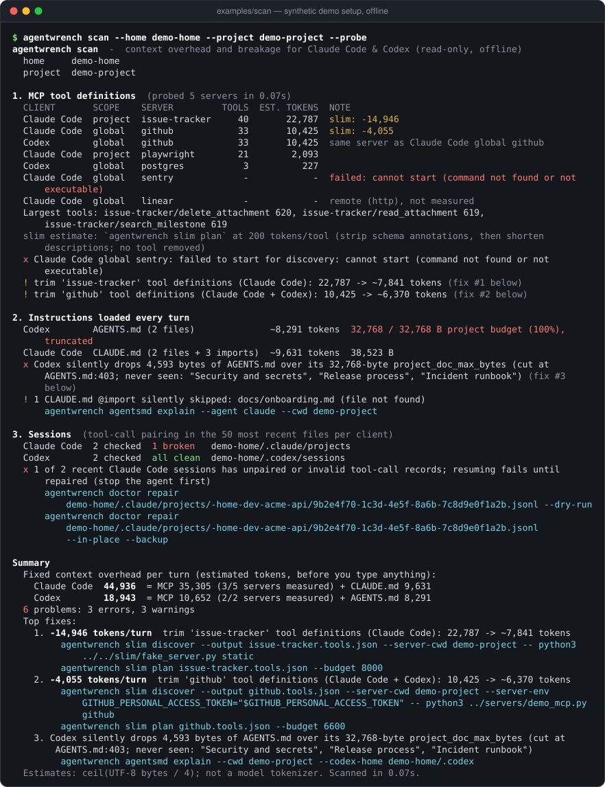
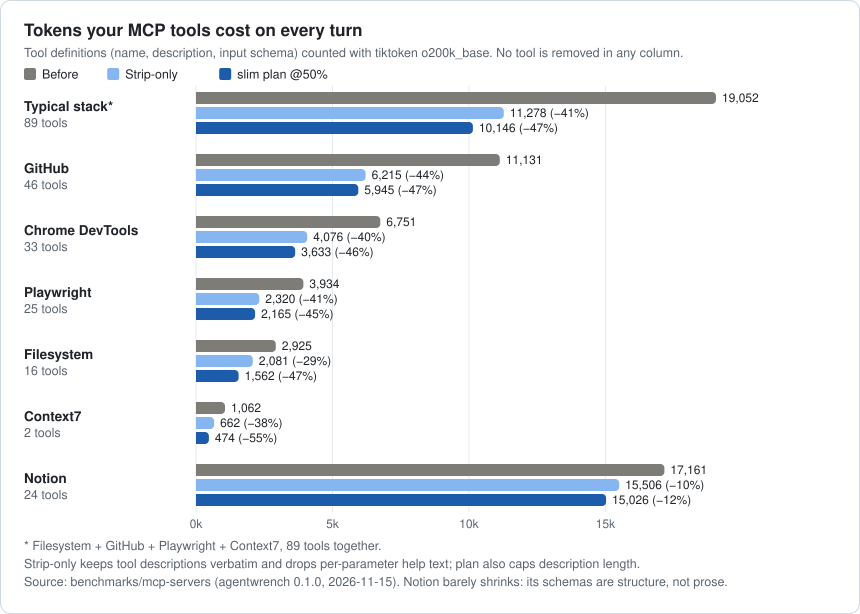

<p align="center">
  <picture>
    <source media="(prefers-color-scheme: dark)" srcset="assets/logo-dark.svg">
    
  </picture>
</p>

<p align="center">
  <strong>找出你的编程代理配置在暗中多花的 token 和埋下的故障，然后一条命令修掉。</strong><br>
  一个离线 CLI，覆盖 Claude Code、Codex 和 MCP。
</p>

<p align="center">
  <a href="https://github.com/tianhaogutum/agentwrench/actions/workflows/ci.yml"></a>
  <a href="https://pypi.org/project/agentwrench/"></a>
  <a href="https://pypi.org/project/agentwrench/"></a>
  <a href="LICENSE"></a>
</p>

<p align="center">
  <a href="README.md">English</a> · 简体中文
</p>

<p align="center">
  <strong>89 个 MCP 工具，每一轮对话固定占用 19,052 个 token。<code>agentwrench slim</code> 把它压到 10,146（−47%），一个工具都不隐藏。</strong><br>
  <sub>Filesystem + GitHub + Playwright + Context7，用 tiktoken <code>o200k_base</code> 实测。<a href="benchmarks/mcp-servers/README.md">基准测试与方法</a>。</sub>
</p>

```sh
uvx agentwrench scan          # 或：pipx install agentwrench  /  pip install agentwrench
```

<p align="center">
  
</p>
<p align="center"><sub>仓库自带的合成演示环境（<code>examples/scan</code>，虚构的服务器，不联网）上的真实输出，可用 <code>assets/render_terminal.py</code> 重新生成。</sub></p>

## 快速开始

```sh
uvx agentwrench scan            # 只读：当前项目、~/.claude.json、~/.claude、~/.codex
uvx agentwrench scan --probe    # 另外把每个 stdio MCP 服务器启动一次，统计工具定义的 token
```

不用注册，不用 API key，也不用写配置。不想碰自己的环境？克隆仓库后跑上面那个演示：

```sh
git clone https://github.com/tianhaogutum/agentwrench && cd agentwrench
uvx agentwrench scan --home examples/scan/demo-home --project examples/scan/demo-project --probe
```

长期使用可以 `pipx install agentwrench` 或 `pip install agentwrench`（需要 Python 3.11+；支持 Linux 和 macOS，Windows 未经测试）。

## `scan` 会查什么

| 部分 | 统计什么 | 标出什么问题 | 用哪个命令修 |
| --- | --- | --- | --- |
| MCP 工具定义 | 每个服务器的工具每轮占多少 token，按客户端和作用域分开（Claude Code 的 global/local/project，Codex 的 global/project） | 值得精简的服务器、启动失败的服务器、被两个客户端重复加载的服务器 | [`slim`](#把-mcp-工具定义砍掉一半slim) |
| 每轮都加载的指令文件 | AGENTS.md 链对照 Codex 32 KiB 的项目预算；CLAUDE.md 及其 `@import` | Codex 悄悄丢掉的字节和它永远看不到的标题；Claude Code 悄悄跳过的 `@import` | [`agentsmd`](docs/agentsmd.md) |
| 会话 | 每个客户端最近 50 个会话文件里工具调用是否成对 | 一 `--resume` 就会失败的会话 | [`doctor`](docs/doctor.md) |
| 交接包（仅当项目里有交接包时显示） | 项目里每个 `agentwrench handoff` 交接包是否仍与仓库一致 | 已过期或被改动过的交接包 | [`handoff`](#测试通过了可到底是哪份代码-handoff) |

最后的汇总按客户端算出"你还没打字，每轮就已经固定占用的上下文"，并按节省的 token 排出前三个修复，每个都附上可以直接运行的命令。`--json` 输出稳定的 schema（[`agentwrench.scan/v1`](docs/scan.md#json-output)）；`--fail-over 30000` 在固定开销超过 3 万 token 时以退出码 1 结束，适合放进 CI。详见 [docs/scan.md](docs/scan.md)。

## 把 MCP 工具定义砍掉一半：`slim`

每次请求，MCP 客户端都会把所有工具的名称、描述和输入 schema 发给模型。`slim` 先量出这部分有多大，再按你给的 token 预算生成配置，通过一个 stdio 代理提供精简后的工具列表。它先去掉参数级的说明文字，不够再缩短工具描述；除非你明确要求，否则不会删掉任何工具。

<p align="center">
  <picture>
    <source media="(prefers-color-scheme: dark)" srcset="assets/slim-benchmark-dark.svg">
    
  </picture>
</p>

| MCP 组合（tiktoken `o200k_base`） | 工具数 | 精简前 | 只去参数说明 | `slim plan`（50% 预算） |
| --- | --: | --: | --: | --: |
| **Filesystem + GitHub + Playwright + Context7** | 89 | **19,052** | 11,278 (−41%) | **10,146 (−47%)** |
| GitHub MCP 2.1.0，默认 toolsets | 46 | 11,131 | 6,215 (−44%) | 5,945 (−47%) |
| GitHub MCP 2.1.0，`--toolsets all` | 91 | 23,138 | 12,360 (−47%) | 12,294 (−47%) |
| Chrome DevTools MCP 1.13.0 | 33 | 6,751 | 4,076 (−40%) | 3,633 (−46%) |
| Playwright MCP 0.0.85 | 25 | 3,934 | 2,320 (−41%) | 2,165 (−45%) |
| Notion MCP 2.6.1 | 24 | 17,161 | 15,506 (−10%) | 15,026 (−12%) |

"只去参数说明"一字不改地保留每个工具的描述，在这个组合上依然省下 41%。Notion 几乎压不下来，因为它的 schema 是结构而不是说明文字。11 个服务器的完整数据、测量方法和注意事项见 [benchmarks/mcp-servers](benchmarks/mcp-servers/README.md)，用法和限制见 [docs/slim.md](docs/slim.md)。

```sh
agentwrench slim discover --output fs.tools.json -- npx -y @modelcontextprotocol/server-filesystem .
agentwrench slim plan fs.tools.json --budget 1700 > fs.slim.json     # 分析打印到 stderr，配置输出到 stdout
agentwrench slim measure fs.tools.json --config fs.slim.json         # 对比前后，不启动任何进程
```

然后让客户端启动代理而不是原来的服务器（`--config` 请写绝对路径）：

```json
{ "command": "agentwrench",
  "args": ["slim", "proxy", "--config", "/abs/path/fs.slim.json", "--",
           "npx", "-y", "@modelcontextprotocol/server-filesystem", "/abs/path/project"] }
```

## 哪里疼，就用哪个

### 提示词缓存总是不命中 → `cache`

工具列表换了个顺序，或者系统提示里带了个时间戳，前缀缓存就悄悄失效，整段提示按全价计费。把你发出去的请求体交给 `cache`（JSONL，支持 Anthropic Messages、OpenAI Chat/Responses），它会指出相邻两次请求从哪个 JSON 路径开始不再共享前缀、原因是什么（`tool_reordered`、`system_changed` 等），并和记录下来的 usage 对账。加上 `--fail-on` 就是一道 CI 关卡。[文档](docs/cache.md) · [示例输出](benchmarks/demos.md#1-cache-analyze-which-json-path-broke-the-prompt-cache-and-why)。

```sh
agentwrench cache analyze requests.jsonl --fail-on tool_reordered,system_changed
```

### 工具结果或测试日志太大 → `sift`

一份 80 KB 的 pytest 报告或 MCP 结果，要么塞满上下文，要么被盲目截断。`sift` 按源文件原样保留失败记录、退出码和 `isError`，附上字节范围以及 JSON Pointer 或行号，列出每一段被省略的范围，并让整个结果符合 tiktoken 计量的 token 预算。`recover` 可以从原文件取回任意被省略的范围。需要安装 `sift` 扩展。[docs/sift.md](docs/sift.md)

```sh
agentwrench sift summarize report.json --format json --budget 1500 --keep /exit_code > evidence.json
```

### Codex 没读到 AGENTS.md 的后半段 → `agentsmd`

Codex 默认最多加载 32 KiB 的项目指令文件，超出的部分直接丢弃，不给任何提示。`agentsmd` 列出加载了哪些文件、截断发生在哪个字节哪一行，以及代理永远看不到的每个标题。它也会检查 CLAUDE.md 的 `@import`。[docs/agentsmd.md](docs/agentsmd.md)

```sh
agentwrench agentsmd explain --cwd .                 # 加 --agent claude 检查 CLAUDE.md
```

### 会话中断后 `--resume` 失败 → `doctor`

会话里只存了工具调用却没有结果（或者反过来），服务商就会拒绝整段对话。`doctor` 找出 Claude Code 和 Codex 会话 JSONL 里不成对的调用，并保守地修复：先给你看 diff，再写到新文件（或带备份原地替换）。不需要改动的行逐字节保留；被中断的调用会补上一条带标记的占位结果，找不到对应调用的输出记录会被删除（`--strategy drop` 则改为删除未完成的调用）。[docs/doctor.md](docs/doctor.md)

```sh
agentwrench doctor repair path/to/session.jsonl --dry-run    # 确认后：--out fixed.jsonl
```

### 要把会话交接给别人 → `export`

把 Codex、Claude Code 或 Cline 的会话变成脱敏后的 Markdown 交接简报（第一个和最后一个请求、改过的文件、跑过的命令），或者转成可以合并、对比的 ATIF / 标准化 JSONL 轨迹。[docs/export.md](docs/export.md)

```sh
agentwrench export summary path/to/session.jsonl -o handoff.md
```

### Codex 的补丁打不上 → `patch`

在 Codex 之外解析、试运行并原子地应用 `apply_patch`（V4A）补丁，和 unified diff 互相转换，并逐个 hunk 解释为什么没匹配上。[docs/patch.md](docs/patch.md)

```sh
agentwrench patch apply change.patch --root . --dry-run
```

### 同一批 MCP 服务器要写五种配置 → `mcp-config`

在 Claude Code、Codex、Cline、Continue 和 VS Code 之间转换服务器定义，并报告每个会丢失的字段和每个明文密钥。它从不启动服务器，可以合并进已有文件而不动其他设置，`check` 可以在 CI 里发现配置漂移。[docs/mcp-config.md](docs/mcp-config.md)

```sh
agentwrench mcp-config convert --from claude --to codex .mcp.json
```

### MCP 测试离不开真实服务器 → `cassette`

把一次真实的 MCP stdio 会话录下来，之后在测试里离线回放；支持脱敏，严格模式会检查未匹配和未用到的调用。自带 pytest 插件（`@pytest.mark.mcp_cassette`）。[docs/cassette.md](docs/cassette.md)

```sh
agentwrench cassette record --cassette cassettes/my-server.json -- python3 my_server.py
agentwrench cassette replay --cassette cassettes/my-server.json --strict
```

严格回放把客户端的每个请求和录制时的请求比较；服务器当时协商出更旧的 `protocolVersion` 也没关系，会按录制内容原样回放。

### 在 CI 里无人值守地跑代理 → `gate`

把 `codex exec --json` 或 Claude Code `--output-format stream-json` 的日志标准化，再用 YAML 策略把关：必须跑和禁止跑的命令、允许改动的文件、工具调用次数和 token 上限。支持 JUnit 输出、基线与候选版本对比、导出给 AgentEvals。日志里的任何内容都不会被执行。[docs/gate.md](docs/gate.md)

```sh
agentwrench gate check run.jsonl --policy policy.yaml --junit junit.xml
```

### 智能体的 TypeScript 补丁改出了任务范围 → `fence`

让智能体只修一个函数，它却常常顺手格式化整个文件或"改进"相邻函数。`fence` 以基线（目录或 Git 修订）和精确的符号白名单检查统一 diff，拒绝白名单之外的任何改动（包括空白），且从不应用补丁。退出码 0 通过，1 有范围外改动，2 证据无效。需要安装 `fence` 扩展。[docs/fence.md](docs/fence.md)

```sh
agentwrench fence check --repo . --base HEAD --patch candidate.patch --allow 'src/api.ts::getUser'
```

### “测试通过了”，可到底是哪份代码？→ `handoff`

给下一个智能体写一份交接包：任务（始终标为未验证的声明）、Git 文件清单、脱敏后的 diff 和真实测试运行的记录，输出为 `handoff.json` 和便于阅读的 `handoff.md`。`.env` 之类的敏感文件不会进包。接手方运行 `verify`，不重跑任何命令，就能知道仓库从那以后有没有变。无需额外安装。如果需要验证检查是谁跑的，或者要在 CI 里要求“有一次绑定到当前源码状态的通过运行”，就用 in-toto 回执模式（`record`、`capture`；需要 `handoff` 扩展）。[docs/handoff.md](docs/handoff.md)

```sh
agentwrench handoff run --output ../handoff/tests.json -- python -m pytest -q
agentwrench handoff pack --goal "把重试次数上限设为 5" --evidence ../handoff/tests.json --output ../handoff/pack-01
agentwrench handoff verify ../handoff/pack-01    # 代码一旦对不上就以退出码 1 结束
```

### LangGraph 的 checkpoint 数据库越来越大 → `checkpoints`

看清哪些线程和通道在增长，对比相邻步骤，用字节预算卡住增长，在保留最新状态和待写入数据的前提下清理旧 checkpoint，并留好备份。需要安装 `langgraph` 扩展。[docs/checkpoints.md](docs/checkpoints.md)

```sh
uvx --from 'agentwrench[langgraph]' agentwrench checkpoints stats checkpoints.sqlite
```

## 可信与局限

- **离线，无遥测。** agentwrench 不向任何地方发送数据，也不收集任何数据。唯一的联网例外：`sift` 第一次使用某个 tiktoken 编码时，tiktoken 会下载该编码公开的词表文件（不会发送任何输入数据）；把 `TIKTOKEN_CACHE_DIR` 指向一个已准备好的目录即可保持离线。远程 MCP 服务器只会被 `scan` 列出来，从不连接。
- **默认只读。** `scan`、`check`、`explain`、`report` 和 `measure` 从不修改你的输入文件（`gate check --junit` 只写你指定的报告文件）。会改文件的命令都要显式给出目标或开关（`--out`、`-o`、`--in-place --backup`、`--root`），大多数提供 `--dry-run`，大多数拒绝覆盖已存在的输出文件。
- **哪些会执行代码。** `scan --probe` 用你配置里的命令、参数、环境变量和工作目录启动每个 stdio MCP 服务器，列出工具后关掉。这些是你自己的服务器，它们会做它们本来就做的事（`npx` 服务器可能会下载）。`slim discover`、`slim proxy` 和 `cassette record` 会运行你传给它们的服务器命令，`handoff run` 和 `handoff record` 会运行你传给它们的检查命令。`handoff`、`fence --repo` 以及 `scan`（仅当项目里有交接包时）会以只读方式调用本地 `git`。除此之外不执行任何东西。
- **输出里没有密钥。** `scan` 对环境变量和请求头只报名字，会遮掉命令里的 token，也从不打印指令文件或会话的正文。
- **估算会标明。** `scan` 和 `slim` 打印的是 `ceil(UTF-8 字节数 / 4)` 估算值。和 tiktoken `o200k_base` 相比，它在原始工具列表上偏高 7–18%，对节省比例最多高估 6 个百分点，所以本文的数字都来自分词器实测。目前没有可离线使用的 Claude 分词器，所有数字请按 ±15% 理解。
- **有测试。** 9,000+ 个测试；CI 在 Linux 上覆盖 Python 3.11 到 3.14，另在 macOS 上跑 Python 3.13。需要 Python 3.11+。Apache-2.0 许可。
- **支持的平台。** 支持 Linux 和 macOS。Windows 未经测试，只能部分使用：`scan`、`doctor check` 等只读命令按可用设计，但需要加锁改写文件的命令（如 `doctor repair`）在 Windows 上会拒绝运行。

agentwrench 是独立项目，与 Anthropic、OpenAI 和 Model Context Protocol 项目均无关联。见 [THIRD_PARTY.md](THIRD_PARTY.md)。

## 全部命令

| | 命令 | 文档（英文） |
| --- | --- | --- |
| token 与成本 | `scan`、`slim`、`cache`、`sift` | [scan](docs/scan.md) · [slim](docs/slim.md)（[基准测试](benchmarks/mcp-servers/README.md)）· [cache](docs/cache.md)（[示例](benchmarks/demos.md)）· [sift](docs/sift.md) |
| 会话 | `doctor`、`export`、`gate` | [doctor](docs/doctor.md) · [export](docs/export.md) · [gate](docs/gate.md) |
| MCP | `mcp-config`、`cassette` | [mcp-config](docs/mcp-config.md) · [cassette](docs/cassette.md) |
| 指令文件 | `agentsmd` | [agentsmd](docs/agentsmd.md) |
| 审查 | `fence`、`handoff` | [fence](docs/fence.md) · [handoff](docs/handoff.md) |
| 其他 | `patch`、`checkpoints` | [patch](docs/patch.md) · [checkpoints](docs/checkpoints.md) |

`agentwrench <命令> --help` 会列出所有子命令和选项。`sift`、`fence` 和 `checkpoints` 需要额外安装扩展，`handoff` 的 in-toto 回执子命令也一样：`pip install 'agentwrench[sift,fence,handoff,langgraph]'`（也可以只装用到的）。问题反馈和功能建议请提 [issue](https://github.com/tianhaogutum/agentwrench/issues)。

## 相关项目

[rewind](https://github.com/tianhaogutum/rewind) 是一个独立的 Go 工具：它在 Codex 的每一轮都给你的文件做快照，`rewind to N` 就能撤销某一轮。

---

<p align="center">如果 agentwrench 帮你找出了代理一直在暗中多付的成本，点个 star，让更多人看到它。</p>
