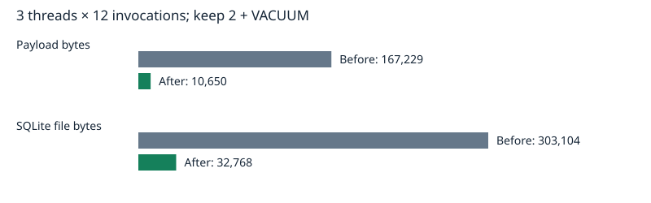

# agentwrench checkpoints

`agentwrench checkpoints` provides offline inspection and verified keep-latest
pruning for **LangGraph SQLite** checkpoint databases. Find growing
threads/channels, see what changed between steps, gate retained-history growth
against byte budgets, and reclaim history while retaining the latest state and
pending writes. No hosted UI, credentials, graph imports, or network calls in the
CLI. Independent of LangChain; see [THIRD_PARTY.md](../THIRD_PARTY.md).

## Install

Requires Python 3.11 or newer. This command needs the `langgraph` extra, which
installs the official `langgraph-checkpoint` and `langgraph-checkpoint-sqlite`
packages used to read and validate checkpoints:

```bash
pip install 'agentwrench[langgraph]'
agentwrench checkpoints --help
```

Without the extra, `agentwrench checkpoints` prints a one-line install hint and
exits 2. `python -m agentwrench checkpoints` is equivalent to
`agentwrench checkpoints`.

The fixture generator used in the examples below additionally needs the
`langgraph` runtime: `pip install 'agentwrench[test]'` or `pip install langgraph`.

## Try a real offline fixture

The generator executes a pure Python graph with list accumulation and a scalar
counter. It normalizes only its own generated IDs, timestamps, task IDs and channel
versions, using the upstream serializer, so repeated runs produce identical
SQLite bytes on the same Python/SQLite versions. Each invocation creates three
checkpoints. It refuses to overwrite an existing file. Usage:
`python examples/checkpoints/make_fixture.py DB [--threads N] [--steps N]`
(run from the agentwrench repository root).

```bash
python examples/checkpoints/make_fixture.py demo.db --threads 3 --steps 12
agentwrench checkpoints threads demo.db
agentwrench checkpoints stats demo.db --thread t-1 --top 5
agentwrench checkpoints diff demo.db --thread t-1 --last 2
agentwrench checkpoints prune demo.db --keep-latest 2 --dry-run
agentwrench checkpoints prune demo.db --keep-latest 2 --backup demo.bak --vacuum
agentwrench checkpoints threads demo.db --json
```

Example diff (last two checkpoints in this fixture; long values shortened here):

```text
"00000000-0000-6000-8000-000000000035" -> "00000000-0000-6000-8000-000000000036"
"branch:to:advance": removed
  before: null
"counter": changed
  before: 11
  after:  12
"items": changed +1 item
  before: ["event-0001", "event-0002", ..., "event-0011"]
  after:  ["event-0001", "event-0002", ..., "event-0011", "even...
```

Example plan:

```text
would delete 102 checkpoints, 171 writes (~156579 payload bytes + 4596 metadata bytes)
plan preserves latest rows; no deletion or workflow was executed
  "t-1" "": 50ed21c3c9163e98b7a95cd89dbe617cf5eee6d81199a435e2fb6aa546e88b47
  "t-2" "": 50ed21c3c9163e98b7a95cd89dbe617cf5eee6d81199a435e2fb6aa546e88b47
  "t-3" "": 50ed21c3c9163e98b7a95cd89dbe617cf5eee6d81199a435e2fb6aa546e88b47
vacuum: not requested
```

The per-group lines are the latest channel-state SHA256 values that execution
verifies are unchanged.

## Commands and output

Each item below is a subcommand of `agentwrench checkpoints` (for example
`agentwrench checkpoints threads DB`). All commands accept `--json`; identifiers in human output are escaped to avoid
terminal control characters. Channel values appear only in `diff` and are
truncated to 160 escaped characters. They may still contain sensitive data.

- `threads DB`: one row per thread, namespace list, checkpoint/write counts, bytes,
  first/last decodable timestamps, metadata bytes (JSON), and opaque checkpoint count.
- `stats DB [--thread T] [--top N]`: ranked channels, growth per checkpoint step,
  largest checkpoints, and opaque byte/count totals. `--top` limits ranked channels
  and largest checkpoints; growth includes all selected steps.
- `diff DB --thread T [--namespace NS] [--from ID --to ID | --last 2]`: channels
  added/removed/changed, escaped truncated values, list length delta and whether a
  changed list is an append (JSON). Default is the last two in the empty namespace.
  Map key order is ignored; list order and scalar types remain significant.
  Opaque inputs produce an explicit diagnostic and exit 2.
- `snapshot DB [--thread T] --json`: save a versioned retained-history byte snapshot
  to stdout for the growth gate (without `--json` it prints a human summary that
  `budget` cannot read). Contains identifiers and byte counts, no state values.
- `budget BASELINE.json CURRENT.json [--policy POLICY.json] [--require-policy-match]
  [--show-policy-coverage] [--show-byte-components] [--show-group-presence]
  [--show-group-presence-summary] [--max-results N] [--max-unused-selectors N]
  [--max-thread-growth-bytes N] [--max-channel-growth-bytes N]`: compare snapshots.
  Use a policy with defaults and exact group overrides, or at least one uniform
  nonnegative limit. Uniform limits apply independently to every group of their kind.
- `prune DB --keep-latest N [--thread T] [--dry-run]
  [--export-plan PLAN.json] [--backup PATH | --no-backup] [--vacuum]`: keep N >= 1 checkpoints, ordered by
  checkpoint ID as in the upstream saver. Execution requires an explicit backup
  choice. A dry-run needs none and never creates a backup, vacuums, or runs a graph.
- `prune DB --apply-plan PLAN.json [--dry-run]
  [--backup PATH | --no-backup] [--vacuum]`: revalidate and resume a saved pruning
  decision. Scope and retention come from the plan; execution still requires an
  explicit backup choice.
- `plan-status DB --plan PLAN.json [--max-differences N] [--json]`: read-only saved-plan diagnostics:
  separate path/schema/raw-row changes and added/removed checkpoint identities
  in the plan's scope. Exit 0 for unchanged, 3 for stale, 2 for invalid input.
- `compare-plans BASELINE.json CURRENT.json [--max-differences N] [--json]`: compare saved keep/delete
  actions without opening a database. Requires identical saved database bindings
  and exact scope. Exit 0 for identical actions, 3 for differences, 2 for invalid
  or incomparable plans.

**Byte accounting:** `bytes` is `len(checkpoint blob) + len(write values)`;
metadata is reported separately. Per-channel state attribution reserializes each
channel value using the upstream serializer and measures its payload (not its type
label or map key), then reports write bytes separately. Channel attribution does
not add up to database payload bytes: checkpoint envelopes, channel keys, and
version maps are overhead. Growth is the signed difference of checkpoint blob +
associated writes from the preceding checkpoint in the same thread/namespace,
not the SQLite file-size delta or an extrapolated cost. Orphan writes count in
inspection but cause prune to refuse. Unknown timestamps are omitted from ranges;
opaque checkpoint bytes are never silently attributed to a channel.

## Read-only checkpoint growth gate

Capture baseline/current snapshots of the same logical database and selection.
For an offline demonstration, generate two real graph histories with different
numbers of invocations (all fixture data is synthetic):

```bash
python examples/checkpoints/make_fixture.py budget-before.db --threads 1 --steps 1
python examples/checkpoints/make_fixture.py budget-after.db --threads 1 --steps 2
agentwrench checkpoints snapshot budget-before.db --json > baseline.json
agentwrench checkpoints snapshot budget-after.db --json > current.json
agentwrench checkpoints budget baseline.json current.json --max-channel-growth-bytes 0 --json
# Exit 3: retained channel history grew; JSON contains exact per-group evidence.
agentwrench checkpoints budget current.json current.json --max-thread-growth-bytes 0 --json
# Exit 0: no growth.
```

For ongoing use, capture both snapshots from your database before and after the
workload. Use the same `--thread T` on both captures, or omit it on both. Snapshot
reads use the existing read-only transaction; the gate opens only the two JSON
files and never runs a graph or prunes data. Save output outside the source DB;
normal shell `>` redirection overwrites its destination before the CLI runs.

Thread groups are `(thread_id, checkpoint_ns)`; channel groups add `channel`.
Namespaces are never merged. Thread `bytes` is all retained checkpoint blobs plus
stored write payloads. Channel `bytes` is all retained reserialized channel values
plus stored writes for that channel, using the byte accounting above, including
valid maps with bytes keys. Snapshots include the separate components. Orphan
writes are counted in their thread/namespace/channel group. Metadata is excluded
from both metrics. Channel attribution excludes the channel name and serializer
type label, but includes keys nested inside values. This measures retained payload
growth, not file-size growth or the size of only the latest state. Pruning can therefore
produce negative growth.

For each selected kind, JSON `comparisons` contains every group in either snapshot,
with `baseline_bytes`, `current_bytes`, signed `growth_bytes`, `limit_bytes`, and
`exceeded_bytes = max(0, current - baseline - limit)`. `violations` contains only
exceeded groups, and `passed` controls exit **0** (all within limits) or **3**
(budget exceeded). Equality passes. New groups start from zero; removed groups
end at zero and do not fail a nonnegative growth allowance. For example, retaining
a 19-byte channel value alongside a baseline 9-byte value yields 28 current bytes:
with allowance 17, growth is 19 and exceeded bytes is exactly 2.

Add `--show-byte-components` for per-row `byte_components` evidence. Thread rows
contain `checkpoint_bytes` and `write_bytes`; channel rows contain
`checkpoint_value_bytes` and `write_bytes`. Each reports `baseline_bytes`,
`current_bytes` and signed `growth_bytes` from that kind's validated snapshot
fields, using zero on an absent side. Human rows show the same names and values.
Components may offset: checkpoint growth -8 and write growth +8 yield total
growth 0, which still passes a zero allowance. Components add no separate limits.

```bash
agentwrench checkpoints budget baseline.json current.json --max-channel-growth-bytes 0 --show-byte-components --json
```

This opt-in evidence composes with policies, row presence/summary and coverage.
It preserves total decisions, effective limits, ordering, exits and complete
validation. Each displayed comparison/violation has components; `--max-results 0`
emits none and output is identical with/without this switch. Omission preserves
existing output. The Python API (`from agentwrench.checkpoints.budget import
budget_report`) accepts `show_byte_components=True`. See the
[exact component contract and negative cases](checkpoints/budget-byte-components.md).

Add `--show-group-presence` to distinguish an absent group from a present
zero-byte group. Every displayed comparison and violation gains JSON booleans
`baseline_present` and `current_present`, based on exact membership in each
validated snapshot. New zero-byte groups have false/true, removed groups true/false,
and common groups true/true. Thread and channel membership are independent,
literal, case-sensitive and namespace-sensitive; a thread without channel entries
does not imply any channel. Human rows append, for example,
`; baseline_present: false, current_present: true`, with ASCII-escaped identifiers.

```bash
agentwrench checkpoints budget baseline.json current.json --max-channel-growth-bytes 0 --show-group-presence --json
# A new zero-byte channel has baseline_bytes=current_bytes=0, but false/true presence.
```

This option works with uniform limits or a policy and can be combined with
`--max-results` and policy coverage. It adds evidence only: byte arithmetic,
override precedence, ordering, full evaluation, coverage and exits are unchanged.
Without it, reports are unchanged. At `--max-results 0`, counts-only output has
no rows or extra presence marker and remains unchanged. All input/resource/strict
coverage errors still refuse with exit 2 and empty stdout. Presence describes
local snapshot declarations, not authenticated provenance or live DB state.
See the [exact presence contract](checkpoints/budget-group-presence.md) for examples and
negative cases. The Python API accepts `show_group_presence=True`.

Add `--show-group-presence-summary` for complete membership counts, including
counts-only runs. The opt-in `group_presence_summary` JSON object contains only
evaluated group kinds (`threads` and/or `channels`), each with exact integer
`baseline`, `current`, `added`, `removed` and `common` counts. Counts use the full
validated indexes, including zero-byte groups and threads with no channels;
identities follow the same literal matching as row presence. An empty evaluated
kind has five zero counts. Human output shows the same counts:

```text
group presence summary:
  channels: 2 baseline, 3 current, 2 added, 1 removed, 1 common
```

```bash
agentwrench checkpoints budget baseline.json current.json --max-channel-growth-bytes 0 --show-group-presence-summary --max-results 0 --json
```

Summary counts and per-row presence are independently optional. Counts are
unchanged by row caps, including zero, and do not change byte-budget failures,
exact independent result totals, overrides, coverage or exits. Without the summary
flag no summary field/block appears. Complete validation and strict coverage
refusals retain exit 2 with empty stdout. The Python API accepts
`show_group_presence_summary=True`; see the [complete count contract](checkpoints/budget-group-presence-summary.md).

Add `--max-results N` to bound displayed budget evidence. Each of `comparisons`
and `violations` independently keeps its first N rows in the existing order:
threads first, then channels, each sorted by the complete literal
`(thread_id, checkpoint_ns[, channel])` identity. JSON additionally includes
`max_results` and `result_summary`, keyed by those two array names, with exact
`total`, `shown`, and boolean `truncated` (`shown < total`) for each. Human output
adds separate comparisons and violations sections with the same counts and
bounded rows; identifiers stay ASCII-escaped. For example:

```bash
agentwrench checkpoints budget baseline.json current.json --policy policy.json --max-results 0 --json
# Arrays are empty, but exact totals and the complete PASS/EXCEEDED decision remain.
```

A zero limit is counts-only; an empty complete array has total/shown 0 and
`truncated: false`. Without this option, JSON fields and human output are unchanged.
The CLI accepts nonnegative ASCII decimal digits only (leading zeros allowed,
subject to Python's integer-string conversion bound); negative, signed, fractional,
empty, whitespace, non-ASCII, and nonnumeric limits exit **2** with empty stdout.
The Python `budget_report(..., max_results=N)` API requires an exact nonnegative
`int` or `None`, rejecting booleans and other types with `ScopeError`.

This is an entry display cap, not a byte, memory, or input-work limit. All snapshots,
policy selectors, comparisons and violations are validated/evaluated before rows
are capped. Hidden violations still cause exit **3**, including at N=0; strict
policy coverage, malformed/duplicate/scope/resource errors still cause exit **2**
with no partial report at any cap. `--show-policy-coverage` keeps complete unused
selector lists unless independently bounded with `--max-unused-selectors` below.
Exact override precedence and coverage counts do not depend on displayed rows.

Add `--max-unused-selectors N` with `--policy` and `--show-policy-coverage`
to independently cap each thread/channel `unused_selectors` list at its first N
literal sorted identities. JSON adds top-level `max_unused_selectors` and each
coverage kind adds `unused_selectors_summary` with exact `total`, `shown` and
boolean `truncated`. Existing `total_overrides`, `covered_overrides` and
`unused_overrides` still describe complete matching, with summary total equal to
unused_overrides. Human output adds `unused selectors: X total, Y shown,
truncated: true/false` under each coverage count line, before escaped identities.

```bash
agentwrench checkpoints budget baseline.json current.json --policy policy.json --show-policy-coverage --max-unused-selectors 0 --max-results 0 --json
# Both coverage lists and budget row lists are empty; all counts/decisions stay exact.
```

Zero hides every unused identity; complete empty lists have total/shown 0 and
truncated false. The cap is independent of `--max-results` and group-presence
rows/summaries. Omission retains existing full coverage output with no new fields
or lines. Only nonnegative ASCII decimal digits are accepted (leading zeros
allowed, subject to Python's integer-string conversion bound); invalid or missing
values fail parsing with exit **2** and empty stdout. Both coverage and policy
options are required. The API `budget_report(..., max_unused_selectors=N)` accepts
only exact nonnegative int or None, rejecting bool and other types. Full input
validation, resource limits, exact union matching, override precedence, hidden
budget failures (exit **3**) and strict unused-selector refusal (exit **2**, empty
stdout) remain unchanged, even at zero. This bounds entries, not bytes or work.
See [the exact contract](checkpoints/budget-unused-selector-limits.md).

Snapshots use `lgckpt-scope.growth/v1` with an explicit thread scope. The gate
rejects different scopes, unsupported versions, duplicate groups/JSON keys,
negative or inconsistent component totals, missing fields, and malformed JSON
with exit **2**, without a passing report. Capture refuses opaque checkpoints or
writes with exit **2** rather than silently undercounting channels; `stats` remains
available for partial inspection. Snapshot files must be UTF-8 JSON, at most
64 MiB and 200,000 combined thread/channel groups; DB selection limits still apply.
Snapshots are local accounting artifacts, not authenticated provenance: keep
baseline/current files intact and choose matching logical workloads yourself.
Percentage limits and latest-state budgets are outside this version.

### Per-group budget policies

Use a policy when application state and internal channels need different growth
allowances. Save this as `policy.json` (example values, not production guidance):

```json
{
  "format": "lgckpt-scope.budget-policy/v1",
  "default": {
    "max_thread_growth_bytes": 4096,
    "max_channel_growth_bytes": 0
  },
  "threads": [],
  "channels": [
    {"thread_id": "t-1", "checkpoint_ns": "", "channel": "items", "max_growth_bytes": 1024},
    {"thread_id": "t-1", "checkpoint_ns": "", "channel": "__start__", "max_growth_bytes": 256}
  ]
}
```

```bash
agentwrench checkpoints budget baseline.json current.json --policy policy.json --json
# Catch stale or mistyped exact override selectors:
agentwrench checkpoints budget baseline.json current.json --policy policy.json --require-policy-match --json
# Audit a reusable policy's unused selectors without rejecting it:
agentwrench checkpoints budget baseline.json current.json --policy policy.json --show-policy-coverage --json
```

Both defaults are mandatory and both kinds are checked. A thread override uses
`thread_id`, `checkpoint_ns`, and `max_growth_bytes`; a channel override also
requires `channel`. Each exact override replaces only its group's default; thread
overrides do not change channel limits. Identifiers are literal and case-sensitive;
there are no wildcard rules. Unused overrides are allowed by default for future
groups. Add `--require-policy-match` to require every override to match its exact
thread or channel group in either snapshot; new, removed and zero-byte groups all
count as matched. A matching thread does not cover an absent channel. Strict
coverage requires `--policy` and refuses an unused selector with exit **2**, an
escaped diagnostic on stderr and no budget report. It diagnoses the first unused
selector in sorted thread-then-channel order. Defaults need not match a group.
Equality passes; zero rejects positive growth. Policy comparisons add
`limit_source` (`default` or `override`), and the report adds `policy_format`.
Human output also identifies the limit source.

Add `--show-policy-coverage` to include `policy_coverage` evidence without changing
budget exit **0**/**3** behavior. For `threads` and `channels` independently, it
reports `total_overrides`, `covered_overrides`, `unused_overrides` counts and
sorted `unused_selectors` identity objects. Matching uses the same exact union
rule, including new, removed and zero-byte groups; defaults are not counted.
Human output escapes unused identifiers. This flag requires `--policy`; combined
with `--require-policy-match`, unused selectors still refuse with exit **2** and
no report. Without the new flag, output is unchanged.

Do not combine `--policy` with uniform-limit flags. Missing/unknown fields,
unsupported versions, duplicate JSON keys/selectors, invalid identifiers or
non-integer/negative limits exit **2** without a report. Policy files are UTF-8
JSON, limited to 1 MiB and 10,000 combined overrides. The gate only reads these
files and the saved snapshots. See the [complete input/output and negative-case
contract](checkpoints/budget-policy.md) for exact examples and validation rules.

## Prune guarantees

1. Open an existing database, validate against the installed saver's actual in-memory
   schema, and acquire `BEGIN IMMEDIATE` before planning an execution. Stop the graph
   writer while pruning. Saved plans are revalidated under that same lock before
   backup or deletion; a stale plan is refused.
2. Decode selected records with a data-only serializer. Refuse unsupported payloads,
   DeltaChannel history, subgraphs, orphan writes, and unknown serializers before
   backup/deletion. There is no `--force` bypass.
3. If requested, use SQLite's backup API from a separate reader while the writer
   lock is held. This includes committed WAL content. The new backup is mode 0600;
   existing files/symlinks and database sidecar paths are refused. Parents must exist.
4. Delete only non-kept checkpoints and their associated writes in one transaction.
   Keep **all** writes of kept checkpoints. Before committing, compare latest
   channel-state SHA256 per selected group and hashes of **every** retained raw
   checkpoint/metadata/write row, then run SQLite `quick_check`. Failure rolls back.
5. Optional `VACUUM` runs after commit because SQLite disallows it in the transaction.
   If it fails, exit 2 explicitly states that prune already committed. Without
   VACUUM, SQLite reuses freed pages; the file usually will not shrink immediately.

`SqliteSaver.prune()` in langgraph-checkpoint-sqlite 3.1.3 is an inherited
**unimplemented** interface, and that release has no SQLite TTL API. Consequently deletion uses our local
transaction, not `delete_thread` or an upstream keep-latest implementation.
An executable API regression test enforces this decision.

The CLI never invokes the graph to verify continuation: doing so would run user
workflows and alter state. Its verification concerns stored state and pending
writes. Real tests prove `graph.get_state(config)` equality and subsequent
`graph.invoke` for the supported flat graphs, including retry after a parallel
node failure without re-executing the successful node.

## Save, review, and resume a prune plan

Export is explicitly a dry-run. The destination must be new, its parent must
exist, and the CLI refuses database/sidecar paths and existing files or symlinks.
The plan is created with mode 0600. It contains checkpoint IDs, keep/delete actions,
scope, retention, byte/count estimates, an absolute resolved database path, and
schema/content SHA256 fingerprints; it contains no state values or execution flags.
New exports use `lgckpt-scope.prune/v2` with bounded per-checkpoint/write raw-row
fingerprints across the whole DB. Legacy v1 plans remain valid for application
and diagnosis. Protect local fingerprints: hashes may permit guessing low-entropy
values. See the [versioned artifact contract](checkpoints/prune-plan-v2.md).

```bash
python examples/checkpoints/make_fixture.py planned.db --threads 2 --steps 4
agentwrench checkpoints prune planned.db --thread t-1 --keep-latest 2 --dry-run --export-plan reviewed.json --json
# reviewed.json: 12 selected checkpoint IDs, 10 delete actions, 2 keep actions.
agentwrench checkpoints prune planned.db --apply-plan reviewed.json --dry-run --json
# Preview again without backup creation, deletion, or VACUUM.
agentwrench checkpoints prune planned.db --apply-plan reviewed.json --backup planned.bak --vacuum --json
# Deletes exactly the 10 reviewed checkpoints and associated writes; verifies retained rows.
```

`--apply-plan` cannot be combined with `--keep-latest`, `--thread`, or
`--export-plan`. Choose `--backup PATH` or `--no-backup` at execution time;
`--vacuum` is also chosen then. These options are never inherited from a plan.
Dry-run skips backup and VACUUM even if those flags are supplied.

The binding covers **every raw checkpoint, metadata and write row in the whole
database**, including unselected threads and committed WAL content, plus schema
SQL, schema version, user version and application ID. Applying to another resolved
path, adding/removing checkpoints, changing pending writes/metadata, or changing
schema makes it refuse with exit **2**, before backup creation or deletion.
The CLI recomputes the selected IDs, actions and estimates and requires them to
match the file. Malformed JSON, duplicate keys/IDs, unsupported versions and
inconsistent plans also exit 2. Export a new plan after any such database change;
the CLI never silently substitutes a fresh deletion set.

Resume means applying a previously saved decision in **one atomic transaction**,
not incremental batches. A pre-commit failure rolls back and an unchanged plan can
be retried. Successful deletion makes the original plan stale; a no-op plan can
still validate if nothing changed. Physical layout alone is not fingerprinted,
although operations such as VACUUM can change the schema version and invalidate
a plan conservatively. Plans are local review artifacts, not signed authorization;
protect them from edits and treat their paths/identifiers as potentially sensitive.
Export/application apply the existing 200,000-row / 256 MiB limits to the **whole
database**, even with `--thread`. Plan JSON is limited to 64 MiB. This release does
not relocate plans to database copies or rebase them onto changed histories.

### Compare saved prune decisions offline

```bash
agentwrench checkpoints prune planned.db --keep-latest 2 --dry-run --export-plan keep2.json --json
agentwrench checkpoints prune planned.db --keep-latest 1 --dry-run --export-plan keep1.json --json
agentwrench checkpoints compare-plans keep2.json keep1.json --json
# Exit 3: keep_to_delete lists each group's second-newest checkpoint.
agentwrench checkpoints compare-plans keep2.json keep2.json --json
# Exit 0: identical actions. The database need not be present.
```

JSON lists `newly_selected` / `no_longer_selected` action-array membership and
`keep_to_delete` / `delete_to_keep` transitions for common checkpoints, sorted by
exact `(thread_id, checkpoint_ns, checkpoint_id)`. Membership entries also include
their saved action. Selection means presence in the plan, not just deletion.
Namespaces are never collapsed. Input order is baseline then current; array order,
retention settings and estimates alone do not count as action differences.

For bounded output, add `--max-differences N` (nonnegative ASCII decimal integer;
`0` for counts only). Each sorted list shows at most N identities. JSON adds
`max_differences` and `difference_summary` with exact `total`, `shown` and
`truncated` for each list; human headers show those same counts. For example:

```bash
agentwrench checkpoints compare-plans keep2.json keep1.json --max-differences 0 --json
# Empty identity arrays; nonzero totals/truncated=true still give exit 3.
```

The default report is unchanged. Limits at or above a list's total report
`truncated: false`; a complete empty list has total/shown 0 and is never truncated.
Full validation and comparison precede the display cap; it bounds list entries,
not input work or output bytes. Invalid limits exit 2 without reading artifacts.

Both supported plan versions are strictly loaded, including mixed v1/v2 pairs.
The saved path, schema/content binding and thread scope must match exactly; two
v2 plans must also agree on raw-row evidence. Invalid, duplicate, unsupported,
oversized or incomparable inputs exit 2 with no report. Only plan artifacts are
read; no SQLite open, decoding, backup, deletion or rewrite occurs. Output contains
identities/actions, no row bodies, paths or digests. This compares declarations;
it cannot authenticate artifacts or certify prune safety. Applying still requires
database revalidation. See the [complete comparison contract](checkpoints/compare-plans.md).

### Diagnose a stale plan

```bash
agentwrench checkpoints plan-status planned.db --plan reviewed.json --json
# Exit 0 if unchanged; exit 3 with drift evidence after changes.
agentwrench checkpoints plan-status planned.db --plan reviewed.json
```

JSON reports `binding_matches`, independent `path_changed`, `schema_changed`, and
`rows_changed` flags, and sorted `added_checkpoints` / `removed_checkpoints` lists
of `(thread_id, checkpoint_ns, checkpoint_id)` objects. Raw-row changes include
checkpoint payloads, metadata, parent links and pending writes throughout the
**whole database**. `added_checkpoints` / `removed_checkpoints` cover only the
saved plan's scope. V2 also reports `added_database_checkpoints` /
`removed_database_checkpoints` across the whole DB, sorted by the same full
three-part identity. Replacing `(t-2, "", c1)` with `(t-2, "", c3)` after a
`--thread t-1` export lists the exact global addition/removal while both scoped
lists stay empty; `(t-2, "ns", c1)` remains a separate identity. The new lists are
disjoint from same-key `changed_checkpoints` evidence.
V2 diagnostics also list deterministic `changed_checkpoints` and `changed_writes`
across the whole DB for identities present in both saved/current rows. Write keys
include thread, namespace, checkpoint, task ID and integer index. Thus changing c1
metadata and a c2 write without changing IDs lists exactly those two identities;
no row values or hashes are printed. `row_localization="database"` identifies this
coverage. V2 `added_writes` / `removed_writes` enumerate whole-database write
membership differences, sorted by the full five-part key with numeric index
ordering. For example, deleting `(t, "", c2, task, -1)` and inserting
`(t, "", c2, new-task, 2)` lists those exact removed/added identities even when
checkpoint IDs stay fixed. These lists are disjoint from `changed_writes`.
Legacy v1 diagnostics retain format v1 and aggregate drift, with
`row_localization="unavailable-v1"` and null changed/write-membership arrays.
Both new database checkpoint arrays are null for v1 even on unchanged bindings;
human output explicitly marks database checkpoint and write membership unavailable.
V2 diagnostics use status format v2. A removed selected thread lists all
its previous IDs. No payload values, schema SQL or hashes are printed; human
identifiers are escaped.

For bounded identity output, add `--max-differences N` (a nonnegative ASCII
decimal integer; `0` is counts-only). Each of the eight sorted identity lists is
capped independently after complete diagnosis and validation. JSON adds
`max_differences` and `difference_summary`: each available list has exact
`total`, `shown` and `truncated` evidence; unavailable arrays and their summary
entries remain null. Thus a zero-cap stale report can show `[]` with a positive
total and `truncated: true`, while a complete empty list has total/shown 0 and
`truncated: false`. Human headers report the same counts, or `unavailable`.
Default fields/output and exits 0/3/2 are unchanged. Invalid limits exit 2 before
DB/plan reads; resource and artifact checks still run at every valid cap. This
bounds displayed entries, not input work or output bytes.

```bash
agentwrench checkpoints plan-status planned.db --plan reviewed.json --max-differences 1 --json
```

Schema-only changes are distinguished from row changes even for extra indexes or
tables that pruning refuses. If saver tables have incompatible columns or were
replaced by views, row comparison and both ID lists become `null` (unknown), with
a fixed `rows_unavailable_reason`; schema/path evidence is still available.
Changed, database checkpoint membership and write-membership arrays are also null with
`row_localization="unavailable-layout"`. Empty arrays mean no differences; null
means unavailable.
Diagnostics use one read-only transaction with the existing whole-database limits,
include committed WAL rows, and accept no execution flags. They never rebase the
plan. An unchanged binding also revalidates actions/summary so edited plans cannot
be declared current. Application must still revalidate under its writer lock.
See the [base diagnostic contract](checkpoints/plan-status.md) and
[versioned artifact/output and negative-case contract](checkpoints/prune-plan-v2.md).

## Size comparison

The quickstart above (3 threads x 12 invocations, `prune --keep-latest 2
--backup demo.bak --vacuum`) reproduces this measurement: compare `demo.bak`
(the pre-prune backup) with `demo.db`. The recorded run also verified complete
`get_state` equality for all threads and invoked another step on each; sizes
were captured **before** continuation. There is no synthetic speed benchmark.

Recorded run: CPython 3.11.15, SQLite 3.53.1, langgraph 1.2.20,
langgraph-checkpoint 4.3.1, langgraph-checkpoint-sqlite 3.1.3. Exact
machine-readable results: [checkpoints/comparison.json](checkpoints/comparison.json).

| Measurement | Before | After |
| --- | ---: | ---: |
| Checkpoints | 108 | 6 |
| Writes | 180 | 9 |
| Checkpoint + write payload bytes | 167,229 | 10,650 |
| SQLite file bytes | 303,104 | 32,768 |



SQLite version/page allocation affects file sizes; normalized fixture data,
row counts, preserved states and continued counter values are checked separately.

## Development

From the agentwrench repository root:

```bash
uv run --extra test pytest tests/checkpoints
```

Tests are offline, synthetic and single-process (the real parallel-node graph
uses the graph runtime's small local thread pool). They cover deterministic
fixture bytes; direct SQL count/byte attribution; diff additions, removals,
appends and scalars; keep 1/2/all; full state equality and continuation; retained
pending writes and failed-step retry; dry-run file hash; backup restoration and
path refusal; locked/invalid/old schema; unknown types, malformed blobs and unsafe
object revival; namespace mapping/refusal; real DeltaChannel refusal; transaction
rollback on verification failure; and resource boundaries. Growth-gate tests
additionally verify exact byte overages, boundaries, thread/namespace/channel
isolation, saved snapshot validation, real saver bytes-map values, and read-only
file hashes. Policy tests cover exact selector/default isolation, zero overrides,
strict file validation, and limit-source evidence.
Saved-plan tests additionally cover exact keep/delete IDs, delayed application,
stale rows/schema/WAL changes, changed unselected threads, invalid artifacts,
writer-lock revalidation, backup choices, and retry after verification rollback.
Plan-status tests cover exact scoped identity changes, stable-ID content drift,
unselected changes, separate schema drift, unknown rows after incompatible table
changes, read-only WAL diagnostics, escaped identifiers, and malformed inputs.

## Limits and exit codes

- Supports only the exact schema created by the installed `langgraph-checkpoint-sqlite`
  saver (the `langgraph` extra requires `>=3.1.3,<4`; tested with 3.1.3) and
  checkpoint payload v4. It refuses old schemas (including missing `task_path`),
  extra tables/indexes/views/triggers, foreign keys, and unsupported row formats.
  `plan-status` can diagnose schema drift read-only, with unknown row comparisons
  when the saver table layout is incompatible. No migrations; no Postgres/Redis/Platform support.
- Inspection supports multiple namespaces. **Pruning refuses selected threads
  with nonempty namespaces or metadata parent maps** because historical subgraph
  references require graph-aware retention. DeltaChannel is also refused.
- Plain data only: no pickle, JSON object constructors/secrets, MessagePack
  extensions, custom/encrypted serializers or object revival (including message
  class objects). Such blobs count as opaque in inspection; prune refuses them.
  At most 64 container levels / 1,000,000 decoded nodes per blob.
- Selection limits: 200,000 combined checkpoint/write rows, 256 MiB stored payload
  (including metadata), 16 MiB per row. Larger selections fail clearly; inspect
  with `--thread` or split the database offline. This is not a streaming big-data UI.
- History deletion is deliberate: old checkpoint IDs cease to load. Retained
  parent IDs may point to deleted ancestors; current flat-graph continuation does
  not require them. Editing state, preserving time travel, graph migrations,
  reconstructing deltas and guaranteeing arbitrary custom graph semantics are
  out of scope. Keep an offline backup for recovery.
- Reads use read-only SQLite snapshot transactions. With an active WAL database,
  SQLite can use its normal shared-memory bookkeeping; no checkpoint data is
  written. All test dry-runs on closed fixtures preserve file hashes.
- The busy timeout is 250 ms. Exit **0**: success/valid plan; **1**: thread/checkpoint
  not found or insufficient checkpoints for diff; **2**: usage, schema, unsafe
  payload, lock, filesystem, verification, or post-commit VACUUM failure. Exit **3**:
  growth budget exceeded, stale `plan-status` binding, or `compare-plans` action
  differences (the JSON/human evidence is still emitted).

Restore by stopping writers and replacing the database with the backup
using your normal SQLite recovery procedure; do not mix old WAL sidecars with it.
